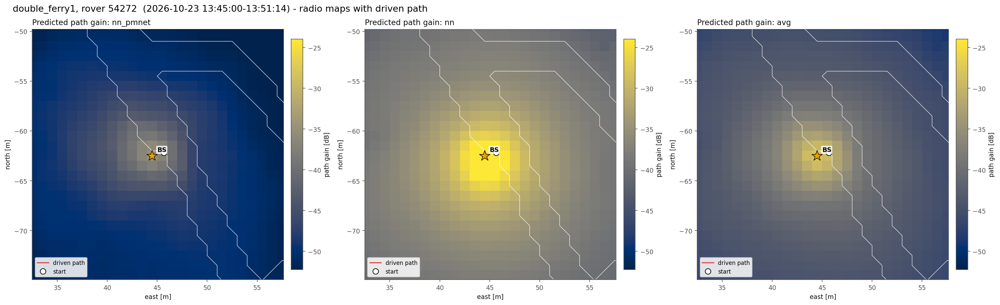
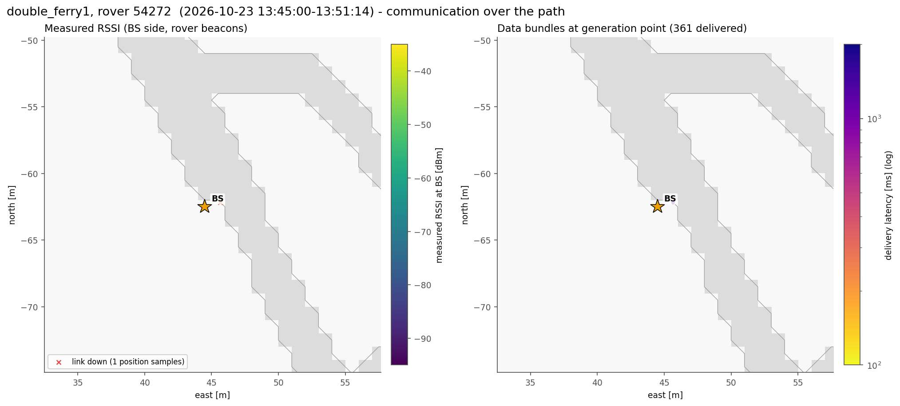
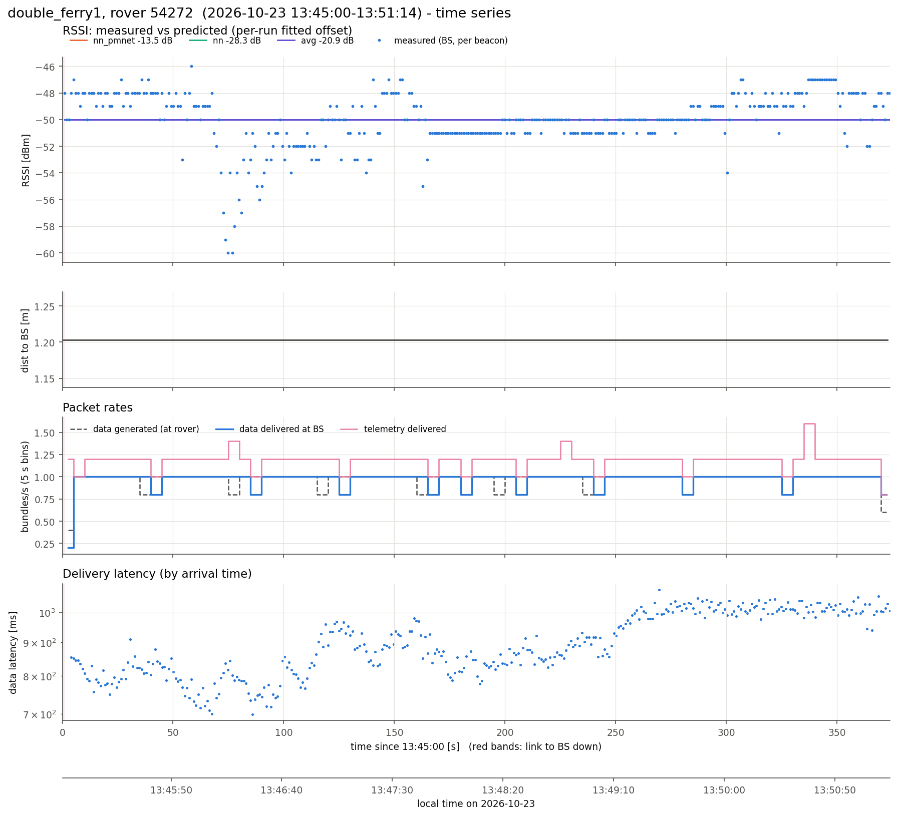
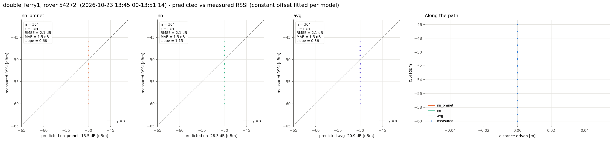
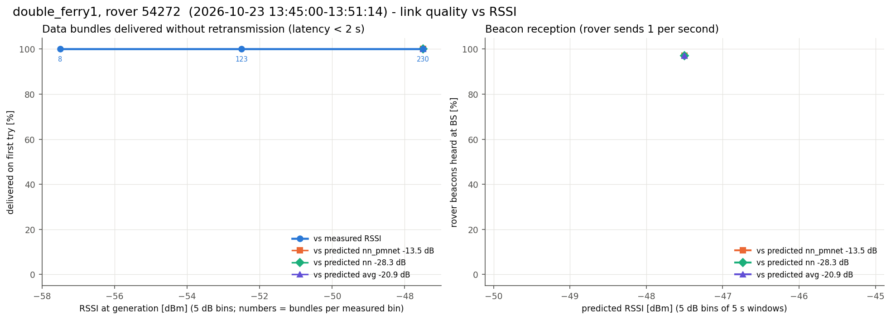

# double_ferry1, rover 54272  (`session_20261023_134500_double_ferry1`)

- Recorded 2026-10-23, 13:45:00 to 13:51:14 local time (UTC-07:00)
- Rover 54272, 374 s, drove 0 m, 1.2-1.2 m from the BS, ended 0.0 m from where it started
- BS at map (+44.5, -62.5) m, cell col 172 row 190 (matches 100% of the logged predictions)
- Link up 100% of the time in 1 contact(s); 364 rover beacons heard at the BS (0.97/s)
- Measured RSSI -60 / -50 / -46 dBm (min / median / max)

## Delivery

| | |
|---|---|
| Data bundles delivered | 361 (rover generated 358) |
| Telemetry delivered | 442 |
| Rover tx / retx | 361 / 0 |
| Data rate | 0.96 bundles/s |
| Latency mean / p50 / p95 / max | 897 / 883 / 1036 / 1083 ms |
| Delivered < 2 s / >= 2 s | 361 / 0 |
| Generated while link down | 0 |

## Predicted vs measured RSSI

Prediction = map path gain + a constant offset (median of measured - predicted).

| Model | n | offset [dB] | r | RMSE [dB] | MAE [dB] | slope |
|---|---|---|---|---|---|---|
| nn_pmnet | 364 | -13.5 | nan | 2.1 | 1.5 | 0.68 |
| nn | 364 | -28.3 | nan | 2.1 | 1.5 | 1.15 |
| avg | 364 | -20.9 | nan | 2.1 | 1.5 | 0.86 |

