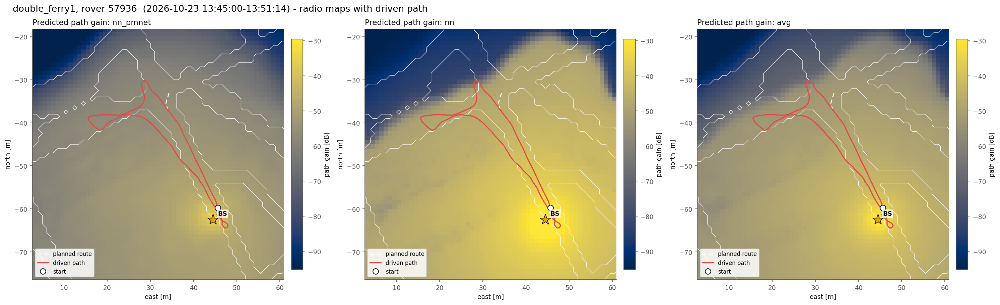
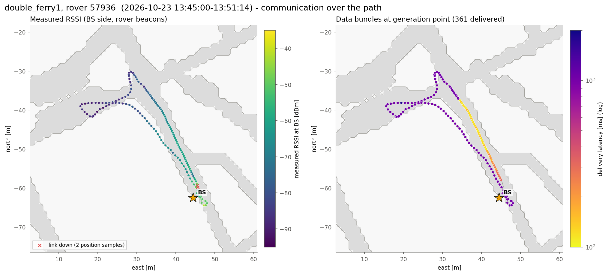
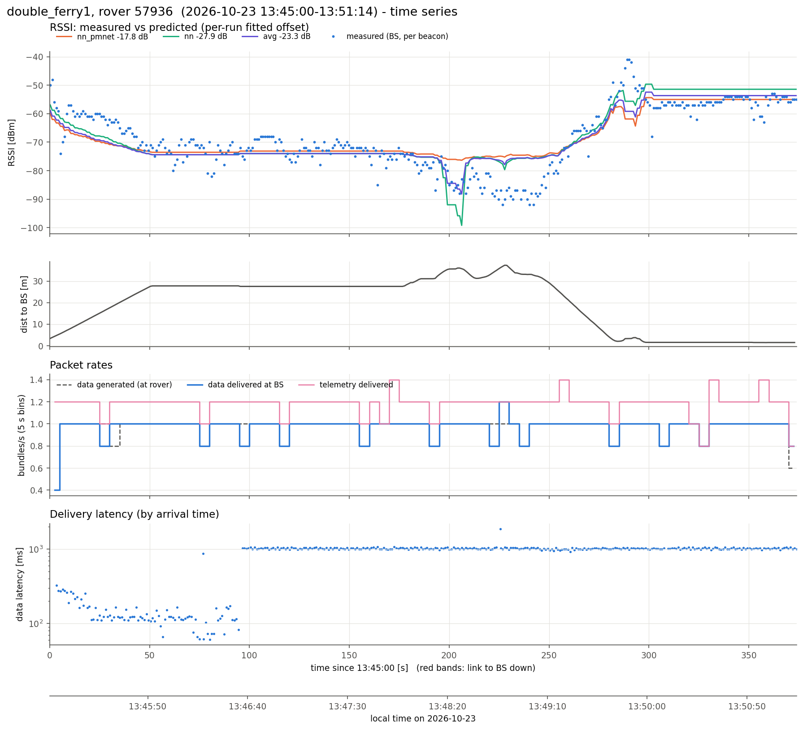
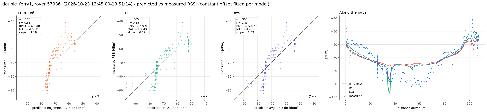
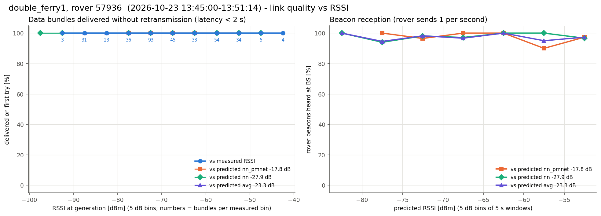

# double_ferry1, rover 57936  (`session_20261023_134500_double_ferry1`)

- Recorded 2026-10-23, 13:45:00 to 13:51:14 local time (UTC-07:00)
- Rover 57936, 374 s, drove 107 m, 1.5-37.3 m from the BS, ended 1.6 m from where it started
- BS at map (+44.5, -62.5) m, cell col 172 row 190 (matches 99% of the logged predictions)
- Link up 100% of the time in 1 contact(s); 365 rover beacons heard at the BS (0.98/s)
- Measured RSSI -92 / -71 / -41 dBm (min / median / max)

## Delivery

| | |
|---|---|
| Data bundles delivered | 361 (rover generated 358) |
| Telemetry delivered | 442 |
| Rover tx / retx | 359 / 0 |
| Data rate | 0.96 bundles/s |
| Latency mean / p50 / p95 / max | 803 / 1006 / 1051 / 1864 ms |
| Delivered < 2 s / >= 2 s | 361 / 0 |
| Generated while link down | 0 |

## Routes

From routes.csv and the nav fields of the rover status (one report every ~5 s). "Following" counts the reports where the rover was driving the route; the rest were mostly RB released (hold_rb). "End to route end" is the distance from the route's last point when it ended (or at the last following report if it never did).

| Sent | Speed | Length | Started | Ended | Progress | Following | Max off route | End to route end |
|---|---|---|---|---|---|---|---|---|
| 13:47:06 | 0.55 m/s | 4.7 m | - | not ended (last: None) | nan m | 0 of 0 reports | - | nan m |

## Predicted vs measured RSSI

Prediction = map path gain + a constant offset (median of measured - predicted).

| Model | n | offset [dB] | r | RMSE [dB] | MAE [dB] | slope |
|---|---|---|---|---|---|---|
| nn_pmnet | 365 | -17.8 | 0.83 | 6.3 | 4.6 | 1.18 |
| nn | 365 | -27.9 | 0.85 | 5.9 | 4.7 | 0.89 |
| avg | 365 | -23.3 | 0.85 | 5.8 | 4.4 | 1.03 |

