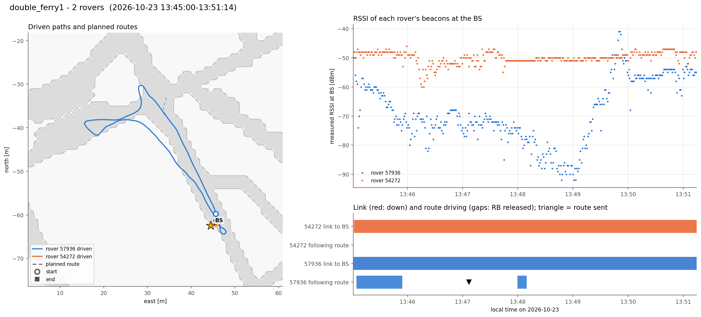

# double_ferry1  (`session_20261023_134500_double_ferry1`)

- Recorded 2026-10-23, 13:45:00 to 13:51:14 local time (UTC-07:00)
- Rovers 57936, 54272
- BS at map (+44.5, -62.5) m, cell col 172 row 190

| Rover | Route sent | Speed | Length | Ended | Progress | Max off route | Driven | Start to end | End to route end | Link up | Contacts | RSSI min / median | Telemetry |
|---|---|---|---|---|---|---|---|---|---|---|---|---|---|
| [57936](57936/summary.md) | 13:47:06 | 0.55 m/s | 4.7 m | no (None) | nan m | - | 107 m | 1.6 m | nan m | 100% | 1 | -92 / -71 dBm | 442 |
| [54272](54272/summary.md) | - | - | - | - | - | - | 0 m | 0.0 m | - m | 100% | 1 | -60 / -50 dBm | 442 |

Per-rover figures and numbers are in the linked folders.

