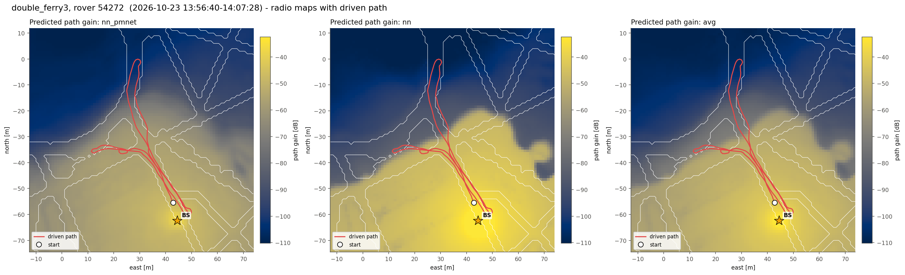
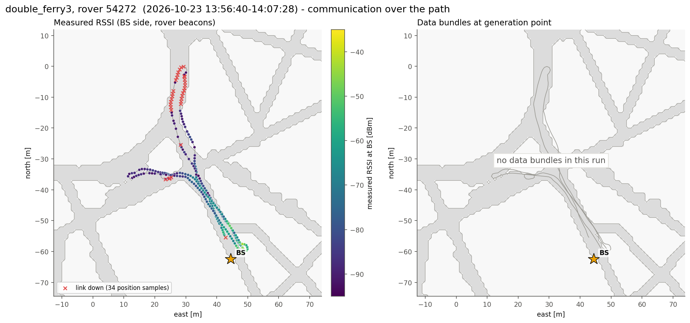
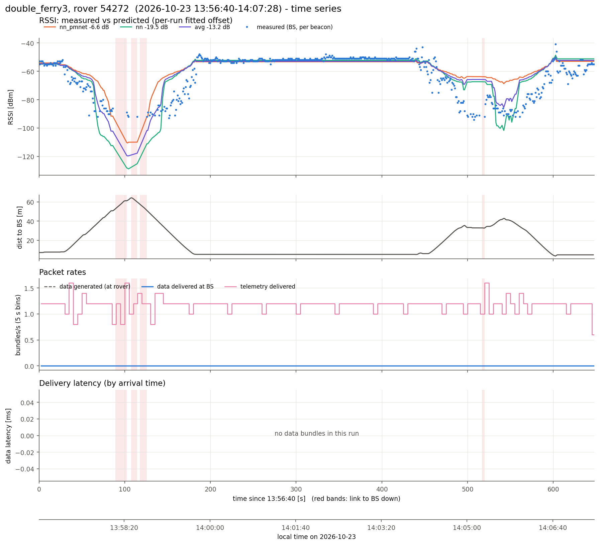
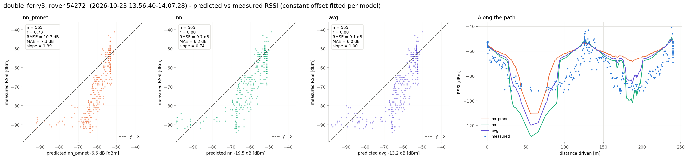
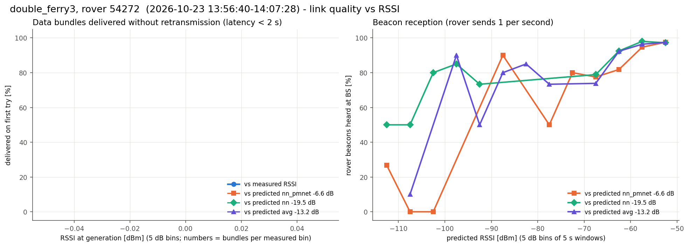

# double_ferry3, rover 54272  (`session_20261023_135640_double_ferry3`)

- Recorded 2026-10-23, 13:56:40 to 14:07:28 local time (UTC-07:00)
- Rover 54272, 648 s, drove 240 m, 3.7-64.3 m from the BS, ended 7.3 m from where it started
- BS at map (+44.5, -62.5) m, cell col 172 row 190 (matches 100% of the logged predictions)
- Link up 95% of the time in 12 contact(s); 565 rover beacons heard at the BS (0.87/s)
- Measured RSSI -94 / -54 / -41 dBm (min / median / max)

## Delivery

| | |
|---|---|
| Data bundles delivered | 0 (rover generated 0) |
| Telemetry delivered | 763 |
| Rover tx / retx | 0 / 0 |
| Data rate | 0.00 bundles/s |
| Latency | no data bundles |
| Delivered < 2 s / >= 2 s | 0 / 0 |
| Generated while link down | 0 |

## Predicted vs measured RSSI

Prediction = map path gain + a constant offset (median of measured - predicted).

| Model | n | offset [dB] | r | RMSE [dB] | MAE [dB] | slope |
|---|---|---|---|---|---|---|
| nn_pmnet | 565 | -6.6 | 0.78 | 10.7 | 7.3 | 1.39 |
| nn | 565 | -19.5 | 0.80 | 9.7 | 6.2 | 0.74 |
| avg | 565 | -13.2 | 0.80 | 9.1 | 6.0 | 1.00 |

