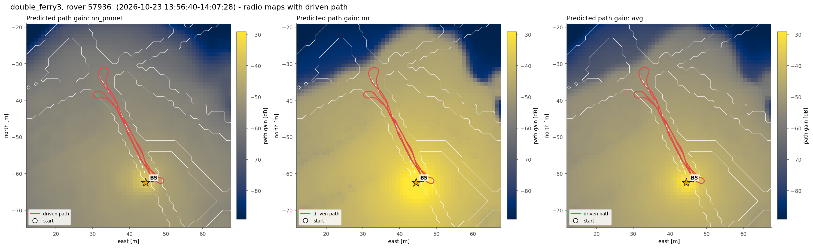
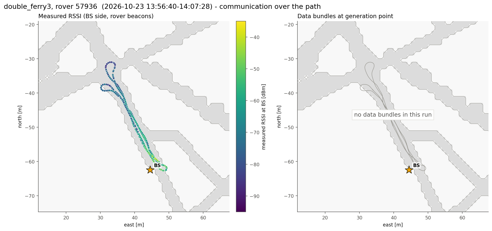
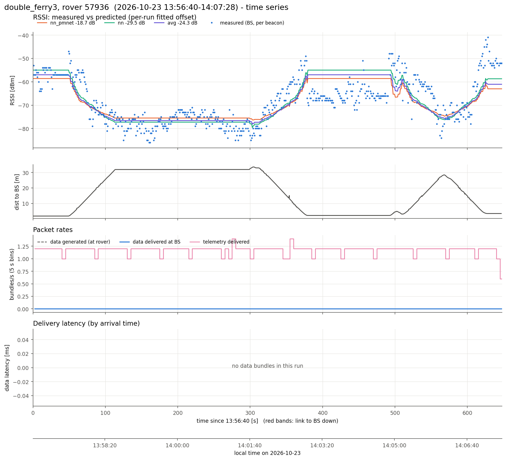
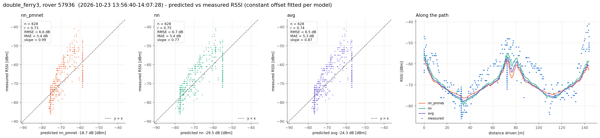
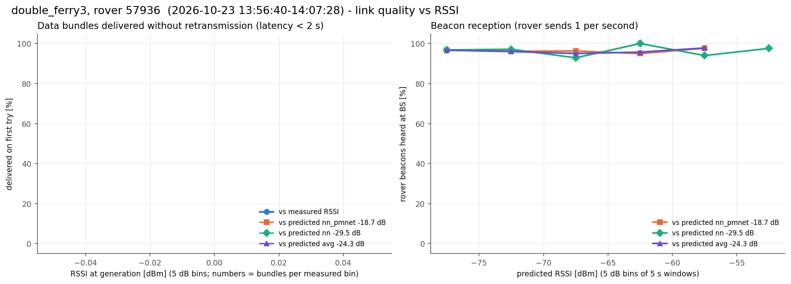

# double_ferry3, rover 57936  (`session_20261023_135640_double_ferry3`)

- Recorded 2026-10-23, 13:56:40 to 14:07:28 local time (UTC-07:00)
- Rover 57936, 648 s, drove 144 m, 1.9-33.6 m from the BS, ended 1.7 m from where it started
- BS at map (+44.5, -62.5) m, cell col 172 row 190 (matches 100% of the logged predictions)
- Link up 100% of the time in 1 contact(s); 628 rover beacons heard at the BS (0.97/s)
- Measured RSSI -86 / -69 / -41 dBm (min / median / max)

## Delivery

| | |
|---|---|
| Data bundles delivered | 0 (rover generated 0) |
| Telemetry delivered | 762 |
| Rover tx / retx | 0 / 0 |
| Data rate | 0.00 bundles/s |
| Latency | no data bundles |
| Delivered < 2 s / >= 2 s | 0 / 0 |
| Generated while link down | 0 |

## Routes

From routes.csv and the nav fields of the rover status (one report every ~5 s). "Following" counts the reports where the rover was driving the route; the rest were mostly RB released (hold_rb). "End to route end" is the distance from the route's last point when it ended (or at the last following report if it never did).

| Sent | Speed | Length | Started | Ended | Progress | Following | Max off route | End to route end |
|---|---|---|---|---|---|---|---|---|
| 14:00:36 | 0.65 m/s | 30.2 m | - | not ended (last: None) | nan m | 0 of 0 reports | - | nan m |

## Predicted vs measured RSSI

Prediction = map path gain + a constant offset (median of measured - predicted).

| Model | n | offset [dB] | r | RMSE [dB] | MAE [dB] | slope |
|---|---|---|---|---|---|---|
| nn_pmnet | 628 | -18.7 | 0.73 | 6.6 | 5.4 | 0.99 |
| nn | 628 | -29.5 | 0.75 | 6.7 | 5.4 | 0.77 |
| avg | 628 | -24.3 | 0.74 | 6.5 | 5.3 | 0.87 |

