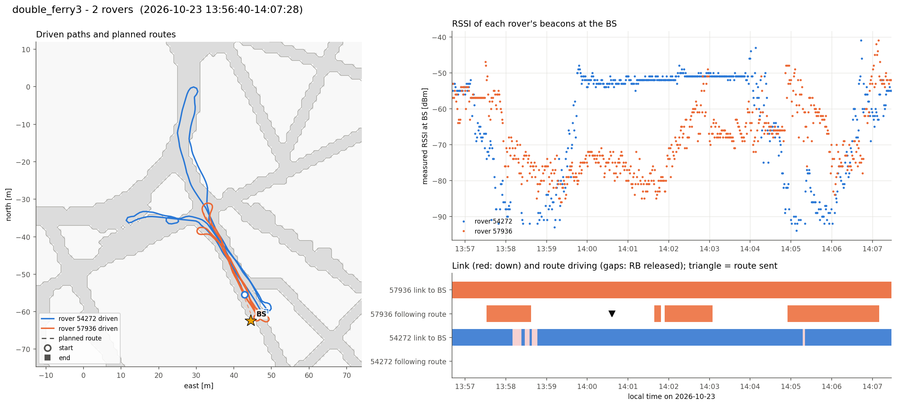

# double_ferry3  (`session_20261023_135640_double_ferry3`)

- Recorded 2026-10-23, 13:56:40 to 14:07:28 local time (UTC-07:00)
- Rovers 54272, 57936
- BS at map (+44.5, -62.5) m, cell col 172 row 190

| Rover | Route sent | Speed | Length | Ended | Progress | Max off route | Driven | Start to end | End to route end | Link up | Contacts | RSSI min / median | Telemetry |
|---|---|---|---|---|---|---|---|---|---|---|---|---|---|
| [54272](54272/summary.md) | - | - | - | - | - | - | 240 m | 7.3 m | - m | 95% | 12 | -94 / -54 dBm | 763 |
| [57936](57936/summary.md) | 14:00:36 | 0.65 m/s | 30.2 m | no (None) | nan m | - | 144 m | 1.7 m | nan m | 100% | 1 | -86 / -69 dBm | 762 |

Per-rover figures and numbers are in the linked folders.

