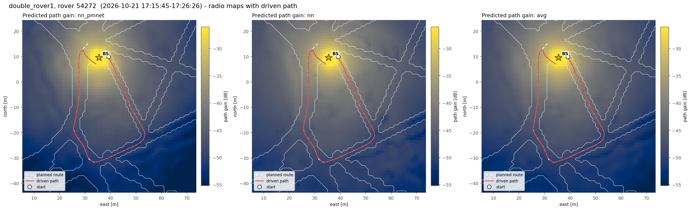
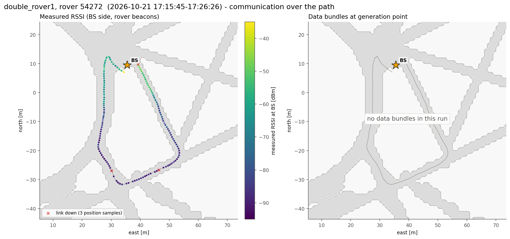
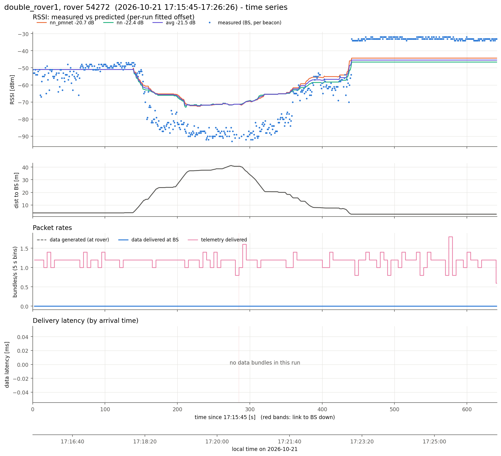
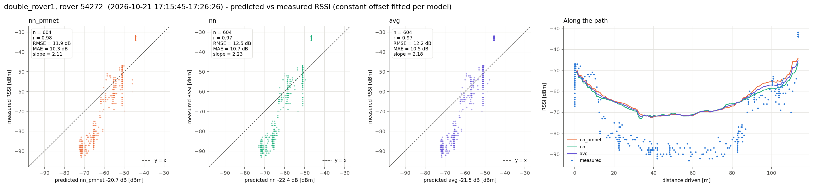
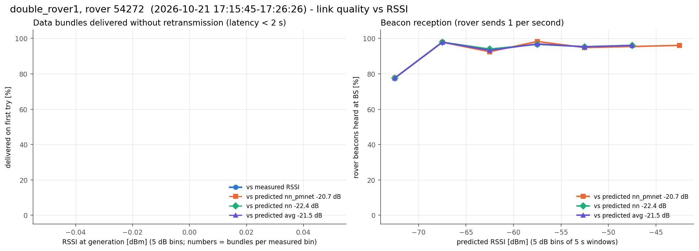

# double_rover1, rover 54272  (`session_20261021_171010_double_rover1`)

- Analysed window: 17:15:45- only

- Recorded 2026-10-21, 17:15:45 to 17:26:26 local time (UTC-07:00)
- Rover 54272, 642 s, drove 114 m, 2.7-41.2 m from the BS, ended 5.6 m from where it started
- BS at map (+35.5, +9.5) m, cell col 163 row 118 (matches 100% of the logged predictions)
- Link up 100% of the time in 6 contact(s); 604 rover beacons heard at the BS (0.94/s)
- Measured RSSI -93 / -54 / -32 dBm (min / median / max)

## Delivery

| | |
|---|---|
| Data bundles delivered | 0 (rover generated 0) |
| Telemetry delivered | 755 |
| Rover tx / retx | 0 / 0 |
| Data rate | 0.00 bundles/s |
| Latency | no data bundles |
| Delivered < 2 s / >= 2 s | 0 / 0 |
| Generated while link down | 0 |

## Routes

From routes.csv and the nav fields of the rover status (one report every ~5 s). "Following" counts the reports where the rover was driving the route; the rest were mostly RB released (hold_rb). "End to route end" is the distance from the route's last point when it ended (or at the last following report if it never did).

| Sent | Speed | Length | Started | Ended | Progress | Following | Max off route | End to route end |
|---|---|---|---|---|---|---|---|---|
| 17:17:45 | 0.75 m/s | 109.1 m | 17:18:08 | not ended (last: hold_rb) | 105.2 m | 29 of 104 reports | 0.1 m | 7.7 m |

## Predicted vs measured RSSI

Prediction = map path gain + a constant offset (median of measured - predicted).

| Model | n | offset [dB] | r | RMSE [dB] | MAE [dB] | slope |
|---|---|---|---|---|---|---|
| nn_pmnet | 604 | -20.7 | 0.98 | 11.9 | 10.3 | 2.11 |
| nn | 604 | -22.4 | 0.97 | 12.5 | 10.7 | 2.23 |
| avg | 604 | -21.5 | 0.97 | 12.2 | 10.5 | 2.18 |

