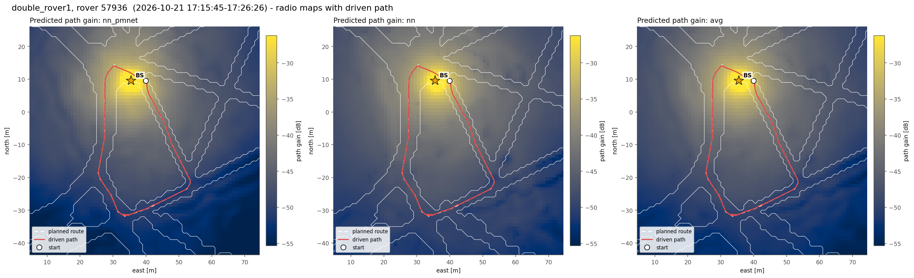
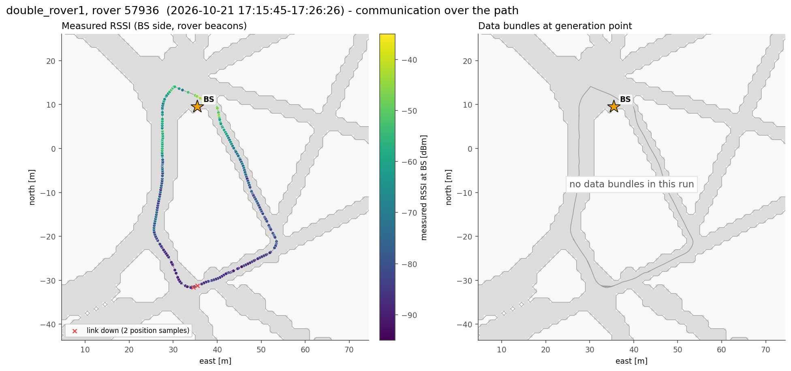
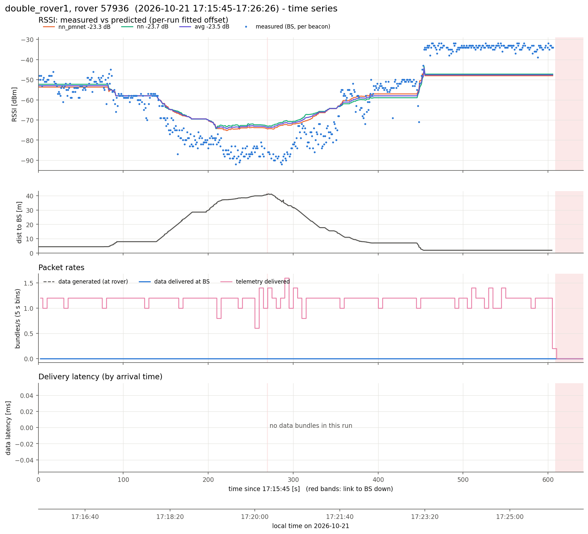
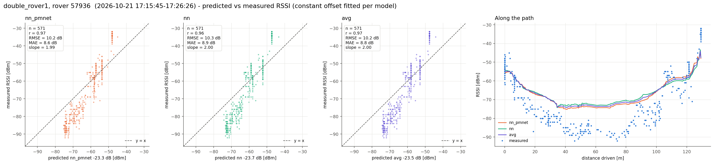
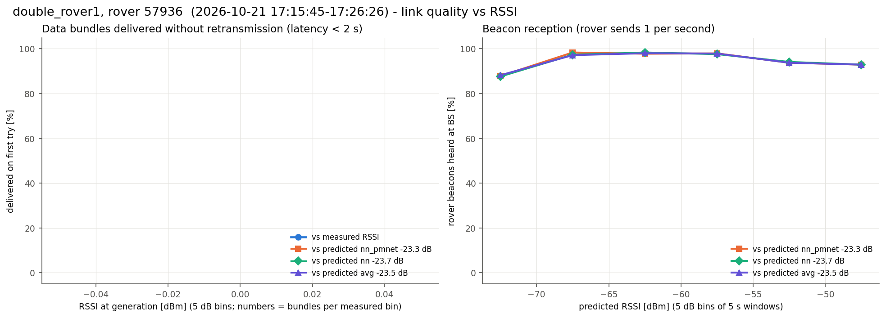

# double_rover1, rover 57936  (`session_20261021_171010_double_rover1`)

- Analysed window: 17:15:45- only

- Recorded 2026-10-21, 17:15:45 to 17:26:26 local time (UTC-07:00)
- Rover 57936, 642 s, drove 129 m, 1.9-41.2 m from the BS, ended 3.0 m from where it started
- BS at map (+35.5, +9.5) m, cell col 163 row 118 (matches 100% of the logged predictions)
- Link up 95% of the time in 5 contact(s); 571 rover beacons heard at the BS (0.89/s)
- Measured RSSI -92 / -57 / -32 dBm (min / median / max)

## Delivery

| | |
|---|---|
| Data bundles delivered | 0 (rover generated 0) |
| Telemetry delivered | 710 |
| Rover tx / retx | 0 / 0 |
| Data rate | 0.00 bundles/s |
| Latency | no data bundles |
| Delivered < 2 s / >= 2 s | 0 / 0 |
| Generated while link down | 0 |

## Routes

From routes.csv and the nav fields of the rover status (one report every ~5 s). "Following" counts the reports where the rover was driving the route; the rest were mostly RB released (hold_rb). "End to route end" is the distance from the route's last point when it ended (or at the last following report if it never did).

| Sent | Speed | Length | Started | Ended | Progress | Following | Max off route | End to route end |
|---|---|---|---|---|---|---|---|---|
| 17:16:47 | 0.5 m/s | 107.2 m | 17:17:09 | done at 17:22:20 | 106.7 m | 43 of 108 reports | 0.2 m | 0.5 m |

## Predicted vs measured RSSI

Prediction = map path gain + a constant offset (median of measured - predicted).

| Model | n | offset [dB] | r | RMSE [dB] | MAE [dB] | slope |
|---|---|---|---|---|---|---|
| nn_pmnet | 571 | -23.3 | 0.97 | 10.2 | 8.6 | 1.99 |
| nn | 571 | -23.7 | 0.96 | 10.3 | 8.9 | 2.00 |
| avg | 571 | -23.5 | 0.97 | 10.2 | 8.8 | 2.00 |

