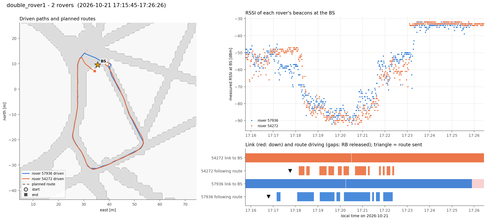

# double_rover1  (`session_20261021_171010_double_rover1`)

- Analysed window: 17:15:45- only
- Recorded 2026-10-21, 17:15:45 to 17:26:26 local time (UTC-07:00)
- Rovers 57936, 54272
- BS at map (+35.5, +9.5) m, cell col 163 row 118

| Rover | Route sent | Speed | Length | Ended | Progress | Max off route | Driven | Start to end | End to route end | Link up | Contacts | RSSI min / median | Telemetry |
|---|---|---|---|---|---|---|---|---|---|---|---|---|---|
| [57936](57936/summary.md) | 17:16:47 | 0.5 m/s | 107.2 m | done 17:22:20 | 106.7 m | 0.2 m | 129 m | 3.0 m | 0.5 m | 95% | 5 | -92 / -57 dBm | 710 |
| [54272](54272/summary.md) | 17:17:45 | 0.75 m/s | 109.1 m | no (hold_rb) | 105.2 m | 0.1 m | 114 m | 5.6 m | 7.7 m | 100% | 6 | -93 / -54 dBm | 755 |

Per-rover figures and numbers are in the linked folders.

