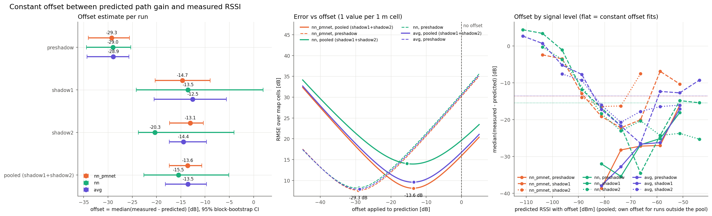

# Prediction offset

offset = median over 1 m cells of median(measured - predicted) per cell; 95% CI = block bootstrap (10 consecutive cells).

| Model | Run | cells | offset [dB] | 95% CI | RMSE raw | RMSE w/ offset | MAE | r | slope |
|---|---|---|---|---|---|---|---|---|---|
| nn_pmnet | preshadow | 166 | -29.3 | -34.0 .. -25.6 | 30.2 | 7.6 | 6.4 | 0.86 | 1.44 |
| nn_pmnet | shadow1 | 147 | -14.7 | -20.3 .. -9.0 | 16.3 | 8.9 | 7.6 | 0.83 | 0.82 |
| nn_pmnet | shadow2 | 109 | -13.1 | -17.3 .. -10.4 | 15.3 | 7.0 | 5.4 | 0.83 | 1.23 |
| nn_pmnet | pooled (shadow1+shadow2) | 256 | -13.6 | -17.4 .. -10.7 | 15.9 | 8.1 | 6.7 | 0.82 | 0.89 |
| nn | preshadow | 166 | -29.0 | -34.4 .. -25.3 | 30.8 | 8.2 | 6.9 | 0.85 | 1.62 |
| nn | shadow1 | 147 | -13.5 | -24.2 .. +1.9 | 20.0 | 15.2 | 13.2 | 0.77 | 0.50 |
| nn | shadow2 | 109 | -20.3 | -23.7 .. -4.0 | 19.2 | 13.1 | 10.6 | 0.87 | 0.50 |
| nn | pooled (shadow1+shadow2) | 256 | -15.5 | -22.6 .. -5.1 | 19.6 | 14.0 | 12.3 | 0.80 | 0.50 |
| avg | preshadow | 166 | -28.9 | -34.3 .. -25.7 | 30.5 | 7.9 | 6.6 | 0.86 | 1.53 |
| avg | shadow1 | 147 | -12.5 | -20.5 .. -5.6 | 17.4 | 11.2 | 9.5 | 0.81 | 0.65 |
| avg | shadow2 | 109 | -14.4 | -17.4 .. -9.7 | 15.9 | 6.8 | 5.6 | 0.88 | 0.74 |
| avg | pooled (shadow1+shadow2) | 256 | -13.5 | -18.2 .. -9.7 | 16.8 | 9.6 | 7.9 | 0.83 | 0.67 |

