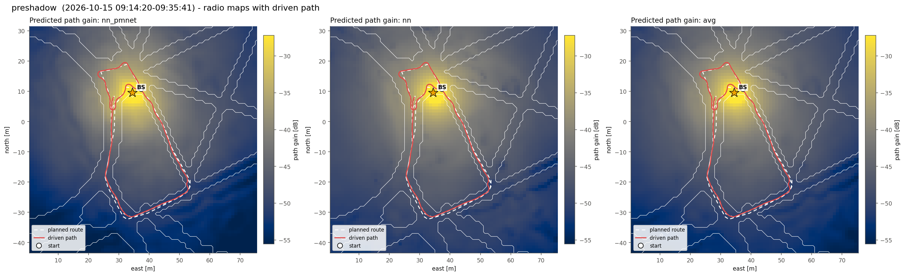
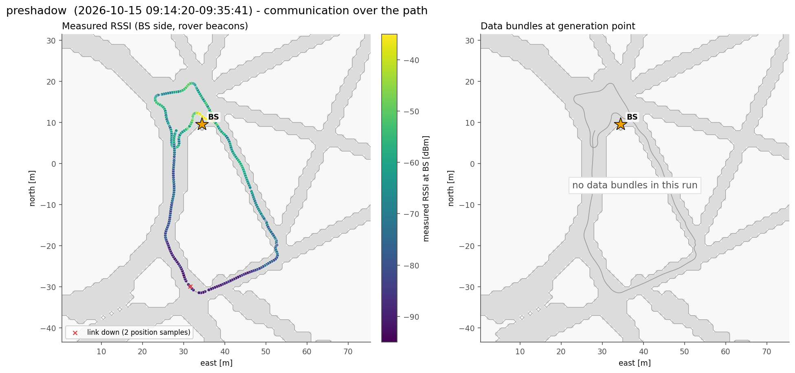
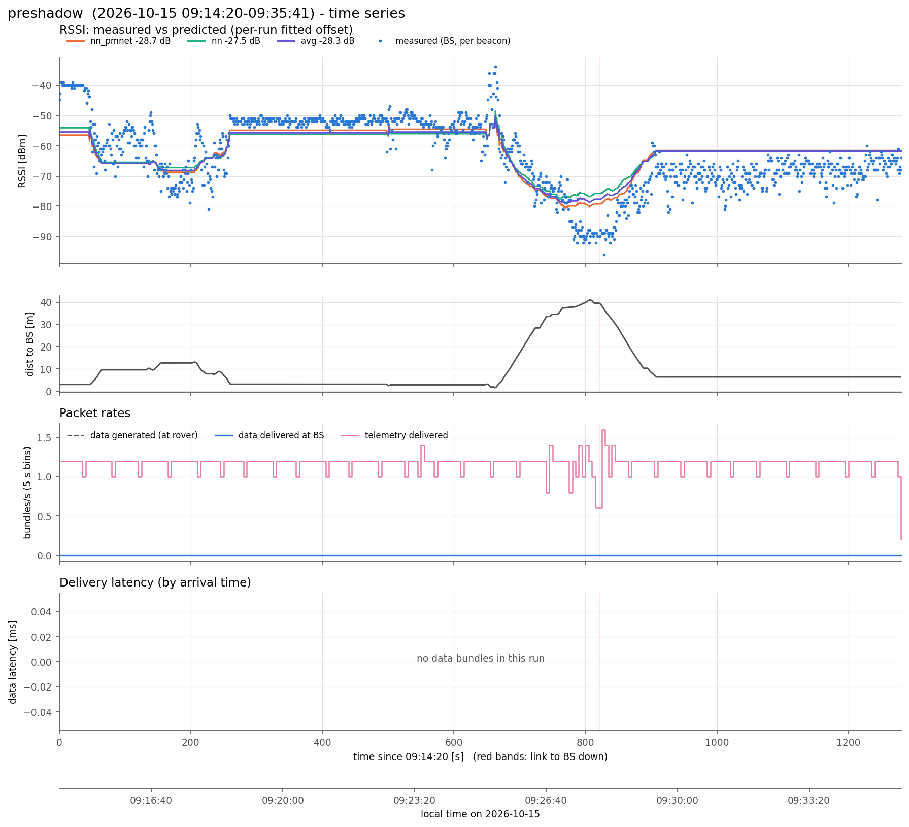
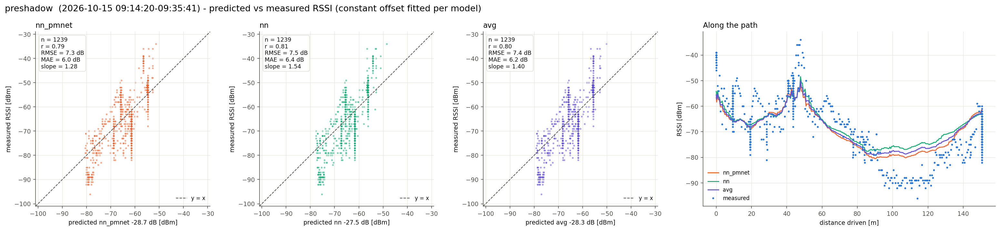
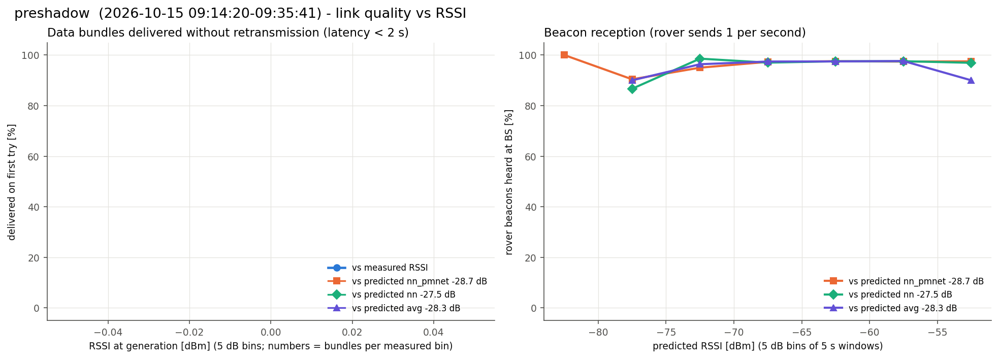

# preshadow  (`session_20261015_091320`)

- Analysed window: 09:14:20-09:35:41 only

- Recorded 2026-10-15, 09:14:20 to 09:35:41 local time (UTC-07:00)
- Rover 57936, 1281 s, drove 151 m, 1.7-41.0 m from the BS, ended 9.5 m from where it started
- BS at map (+34.5, +9.5) m, cell col 162 row 118 (matches 100% of the logged predictions)
- Link up 100% of the time in 3 contact(s); 1239 rover beacons heard at the BS (0.97/s)
- Measured RSSI -96 / -64 / -34 dBm (min / median / max)

## Delivery

| | |
|---|---|
| Data bundles delivered | 0 (rover generated 0) |
| Telemetry delivered | 1502 |
| Rover tx / retx | 0 / 0 |
| Data rate | 0.00 bundles/s |
| Latency | no data bundles |
| Delivered < 2 s / >= 2 s | 0 / 0 |
| Generated while link down | 0 |

## Routes

From routes.csv and the nav fields of the rover status (one report every ~5 s). "Following" counts the reports where the rover was driving the route; the rest were mostly RB released (hold_rb). "End to route end" is the distance from the route's last point when it ended (or at the last following report if it never did).

| Sent | Speed | Length | Started | Ended | Progress | Following | Max off route | End to route end |
|---|---|---|---|---|---|---|---|---|
| 09:14:56 | 0.5 m/s | 9.9 m | 09:15:06 | done at 09:15:25 | 9.3 m | 4 of 15 reports | 0.2 m | 0.6 m |
| 09:16:13 | 0.5 m/s | 9.7 m | 09:16:36 | done at 09:17:01 | 9.3 m | 4 of 16 reports | 0.7 m | 0.5 m |
| 09:17:33 | 0.5 m/s | 20.7 m | 09:17:46 | done at 09:18:41 | 20.1 m | 9 of 57 reports | 0.9 m | 0.6 m |
| 09:22:10 | 0.5 m/s | 99.5 m | 09:22:38 | stopped_off_route at 09:22:43 | 0.0 m | 1 of 17 reports | 0.0 m | 9.6 m |
| 09:24:55 | 0.5 m/s | 107.1 m | 09:25:08 | done at 09:29:31 | 106.5 m | 45 of 127 reports | 1.1 m | 0.6 m |

## Predicted vs measured RSSI

Prediction = map path gain + a constant offset (median of measured - predicted).

| Model | n | offset [dB] | r | RMSE [dB] | MAE [dB] | slope |
|---|---|---|---|---|---|---|
| nn_pmnet | 1239 | -28.7 | 0.79 | 7.3 | 6.0 | 1.28 |
| nn | 1239 | -27.5 | 0.81 | 7.5 | 6.4 | 1.54 |
| avg | 1239 | -28.3 | 0.80 | 7.4 | 6.2 | 1.40 |

