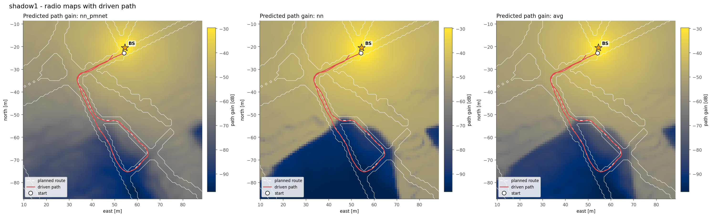
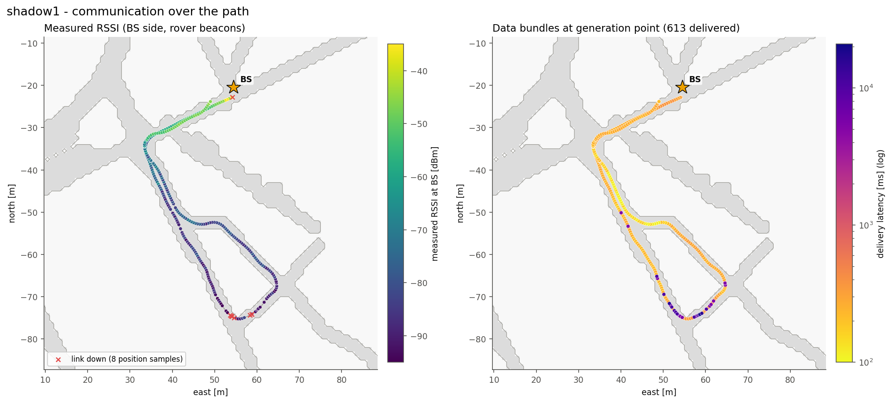
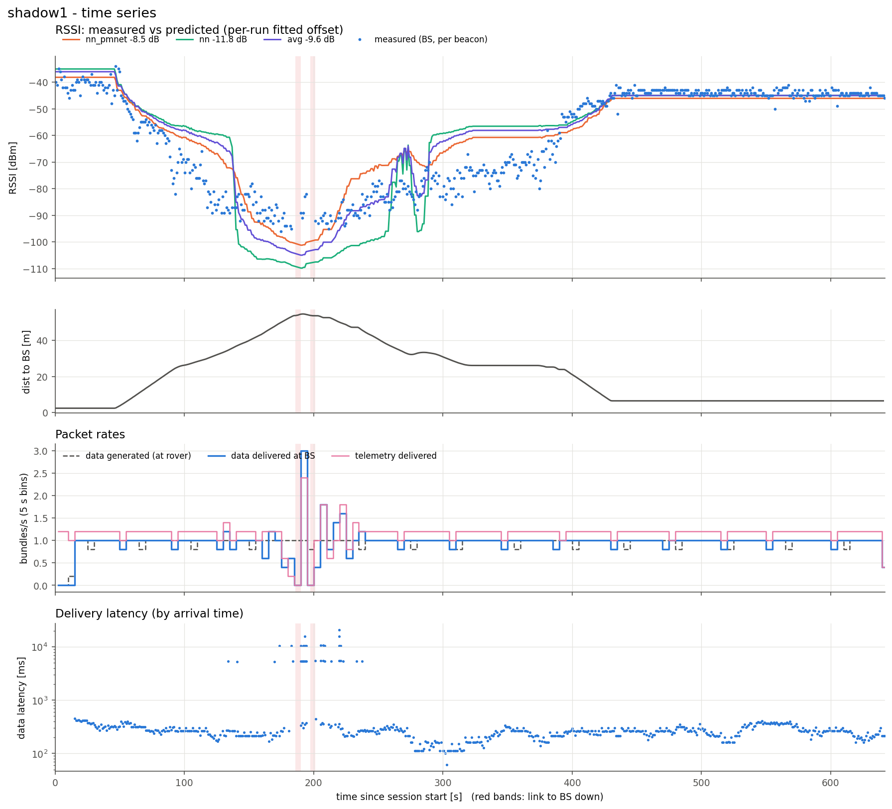
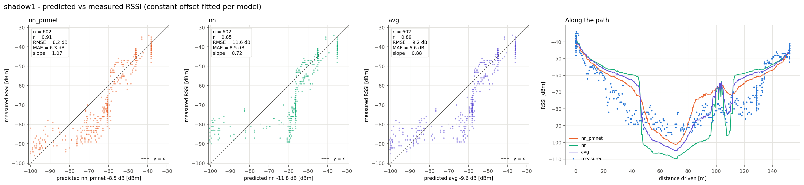
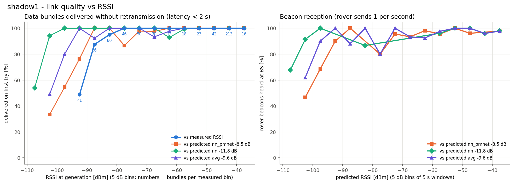

# shadow1  (`session_20261015_094354_shadow1`)

- Rover 57936, 642 s, drove 152 m, 2.3-54.8 m from the BS
- BS at map (+54.5, -20.5) m, cell col 182 row 148 (matches 96% of the logged predictions); data after a mid-session BS move dropped
- Link up 99% of the time in 5 contact(s); 602 rover beacons heard at the BS (0.94/s)
- Measured RSSI -96 / -53 / -34 dBm (min / median / max)

## Delivery

| | |
|---|---|
| Data bundles delivered | 613 (rover generated 609) |
| Telemetry delivered | 742 |
| Rover tx / retx | 660 / 51 |
| Data rate | 0.95 bundles/s |
| Latency mean / p50 / p95 / max | 685 / 263 / 5317 / 20823 ms |
| Delivered < 2 s / >= 2 s | 580 / 33 |
| Generated while link down | 8 |

## Predicted vs measured RSSI

Prediction = map path gain + a constant offset (median of measured - predicted).

| Model | n | offset [dB] | r | RMSE [dB] | MAE [dB] | slope |
|---|---|---|---|---|---|---|
| nn_pmnet | 602 | -8.5 | 0.91 | 8.2 | 6.3 | 1.07 |
| nn | 602 | -11.8 | 0.85 | 11.6 | 8.5 | 0.72 |
| avg | 602 | -9.6 | 0.89 | 9.2 | 6.6 | 0.88 |

