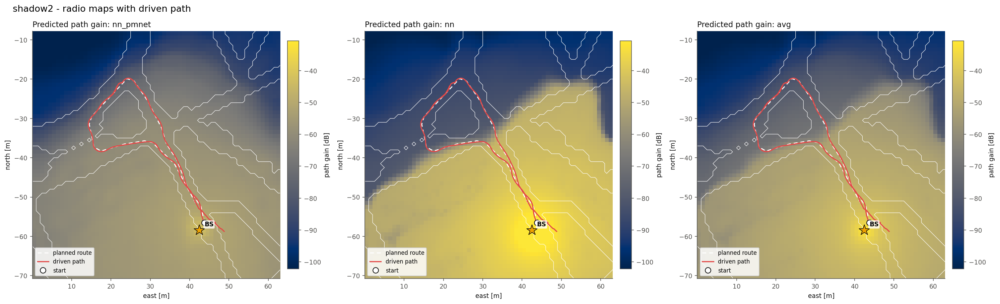
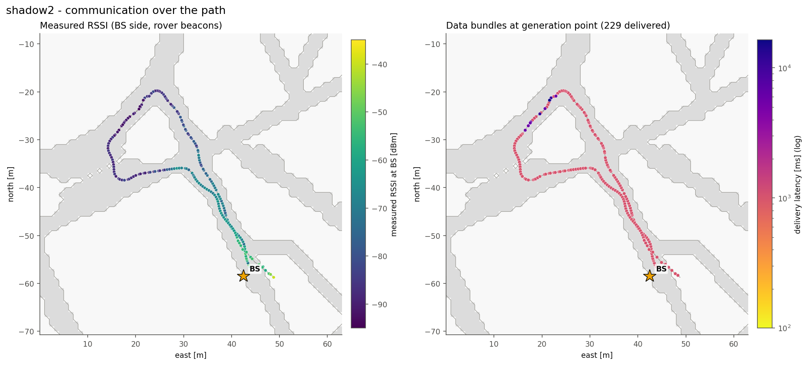
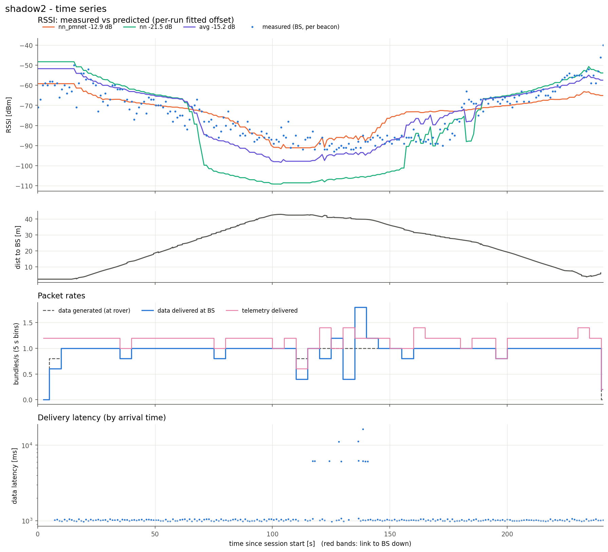
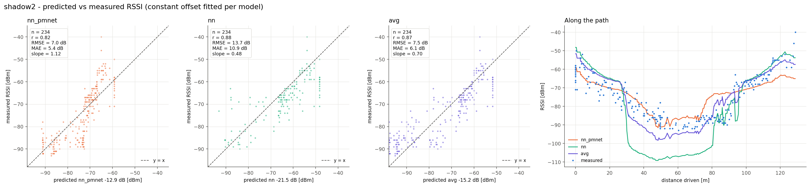
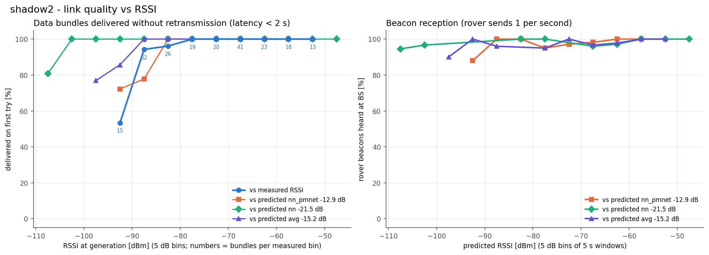

# shadow2  (`session_20261015_095910_shadow2`)

- Rover 57936, 241 s, drove 129 m, 2.3-42.9 m from the BS
- BS at map (+42.5, -58.5) m, cell col 170 row 186 (matches 100% of the logged predictions)
- Link up 100% of the time in 1 contact(s); 234 rover beacons heard at the BS (0.97/s)
- Measured RSSI -93 / -73 / -40 dBm (min / median / max)

## Delivery

| | |
|---|---|
| Data bundles delivered | 229 (rover generated 228) |
| Telemetry delivered | 280 |
| Rover tx / retx | 242 / 15 |
| Data rate | 0.95 bundles/s |
| Latency mean / p50 / p95 / max | 1353 / 1016 / 1071 / 16384 ms |
| Delivered < 2 s / >= 2 s | 218 / 11 |
| Generated while link down | 0 |

## Predicted vs measured RSSI

Prediction = map path gain + a constant offset (median of measured - predicted).

| Model | n | offset [dB] | r | RMSE [dB] | MAE [dB] | slope |
|---|---|---|---|---|---|---|
| nn_pmnet | 234 | -12.9 | 0.82 | 7.0 | 5.4 | 1.12 |
| nn | 234 | -21.5 | 0.88 | 13.7 | 10.9 | 0.48 |
| avg | 234 | -15.2 | 0.87 | 7.5 | 6.1 | 0.70 |

